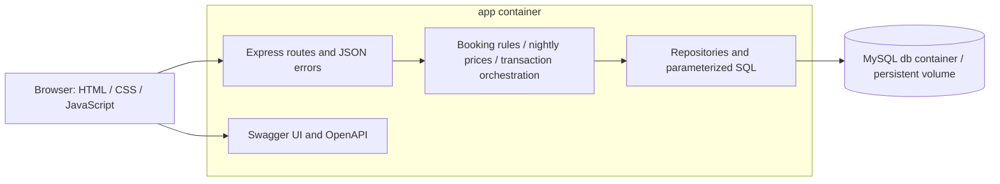

# Hotel Kong Arthur

A local booking prototype built with JavaScript, Express, MySQL, and a plain
HTML/CSS/JavaScript frontend. The backend follows the project's three-layer constitution.

## Start

From a clone of this repository, with Docker and Docker Compose installed:

```bash
docker compose up
```

Open **http://localhost:3000** for the booking page and
**http://localhost:3000/api/docs** for Swagger UI. The first build downloads dependencies;
the app waits for MySQL, creates its tables, and seeds the room/country/tariff catalog
automatically. No host Node/MySQL installation or manual migration command is needed.
Use `docker compose up -d` to leave services running in the background.

| Service | Local address |
| --- | --- |
| Booking frontend | http://localhost:3000 |
| Swagger UI | http://localhost:3000/api/docs |
| Implemented OpenAPI JSON | http://localhost:3000/api/openapi.json |
| Readiness | http://localhost:3000/api/health |
| MySQL for a host database client | 127.0.0.1:3307 |

The app connects internally to `db:3306`. Compose binds exposed ports to the local
computer. It uses local-development credentials by default; optional `.env` overrides
are documented in `.env.example`. Keep existing `.env` credentials when reusing an
already initialized MySQL volume: changing environment values does not reset database
passwords. `.env` is ignored by Git and excluded from the application image.

If port 3000 or 3307 is occupied, set `APP_PORT` or `MYSQL_HOST_PORT` in an optional
`.env` file. `docker compose stop` stops the application without deleting its data.
Normal restarts preserve bookings and do not repeat catalog seeds.

## Implemented booking slice

- Create, list, read, edit, and cancel bookings through browser and JSON API.
- Select specific available rooms from 214 clearly labelled demonstration rooms.
- Generate BookingID, departure, nightly seasonal charges, and exact booking totals.
- Support multiple rooms and recorded guest counts, without per-room guest-capacity checks.
- Reject room overlaps atomically, including simultaneous requests; allow departure-day arrival.
- Reject stale edits with a reload message, preserving the first valid save.
- Confirm browser cancellation; repeat cancellation has no additional effect.
- No login, user accounts, or special duplicate-submission feature.

The room-type catalog, tariff table and generated inventory follow `spec.md` and its
fixture. Country choices are the 20 workbook countries plus Denmark, which appears
in the approved booking acceptance examples. The browser's quantity selectors can
extend to show more values; their initial option count is not a maximum-stay policy.

This slice starts with **no historical bookings**. The 1,000 workbook bookings and
historical bar sales are not imported yet. Reporting endpoints, bar registration,
satisfaction entry, and Tableau integration remain on the task list. The server's
OpenAPI lists only working endpoints; the wider future contract remains under `specs/`.
A browser verification booking may remain as a cancelled record and is not an active stay.

## Three layers and container architecture



- `backend/src/presentation`: HTTP parsing, statuses, JSON errors, Swagger UI and frontend serving.
- `backend/src/services`: validation, seasonal pricing, booking lifecycle, transaction orchestration.
- `backend/src/data`: connection pool, prepared SQL, row locking and persistence.
- `backend/src/startup`: versioned table/catalog initialization.
- `frontend`: plain browser code; it never connects directly to MySQL.

Prices are summed per occupied room-night using that night's season, including arrival
and excluding departure. December is mid season. Money is stored exactly and returned
as decimal strings; the frontend displays one decimal. Booking edits carry a saved
version; room rows are locked in sorted order inside a transaction before checking
availability. No allocation is committed if part of a multi-room request fails.

## Example JSON request

Once the app is healthy and room 001 is available:

```bash
curl -i http://localhost:3000/api/bookings \
  -H 'Content-Type: application/json' \
  -d '{"holderFirstName":"Frederik","holderLastName":"Johansen","holderCountry":"Denmark","guestCount":1,"roomNumbers":["001"],"arrival":"2026-05-31","nights":2}'
```

Expected: HTTP 201, departure `2026-06-02`, total price `2491.00` (1152 + 1339).
Do not supply ID, departure or prices. If the selected room is occupied, use the room
availability endpoint or frontend to choose another room. See Swagger UI for edit and
cancellation requests and the saved `version` required by edits.

## Verification

Pure pricing/date tests on a developer machine:

```bash
cd backend
npm ci
npm test
```

API/MySQL integration tests run in a separate disposable database, never the application
database. From the repository root:

```bash
docker compose --profile test run --build --rm test
```

The integration harness refuses databases whose names do not end in `_test`. It checks
initialization persistence, exact prices, concurrency, rollback, stale edits, repeated
cancellation, input rejection, Swagger/OpenAPI and readiness. The optional test database
has no exposed host port and stores its data in memory.

Browser smoke test with Chrome installed and the application running:

```bash
cd backend
npm ci
npm run test:browser
```

This uses a fresh headless session, creates and edits a clearly named verification
booking, verifies reload persistence, tests cancellation confirmation, and cancels it.
See [the current convergence report](specs/001-hotel-operations/converge.md) for evidence
and outstanding feature work.

## Spec Kit artifacts

- [Constitution](.specify/memory/constitution.md)
- [Specification](specs/001-hotel-operations/spec.md)
- [Plan](specs/001-hotel-operations/plan.md)
- [Tasks and completion state](specs/001-hotel-operations/tasks.md)
- [Implemented API contract](backend/openapi.json)
- [Full future API draft](specs/001-hotel-operations/contracts/openapi.json)

Tableau Public Edition's connection and refresh approach is deferred to the user.
